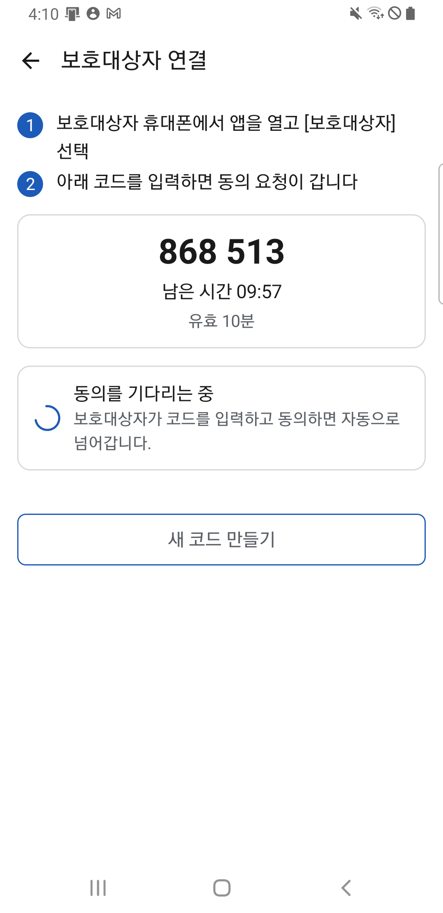
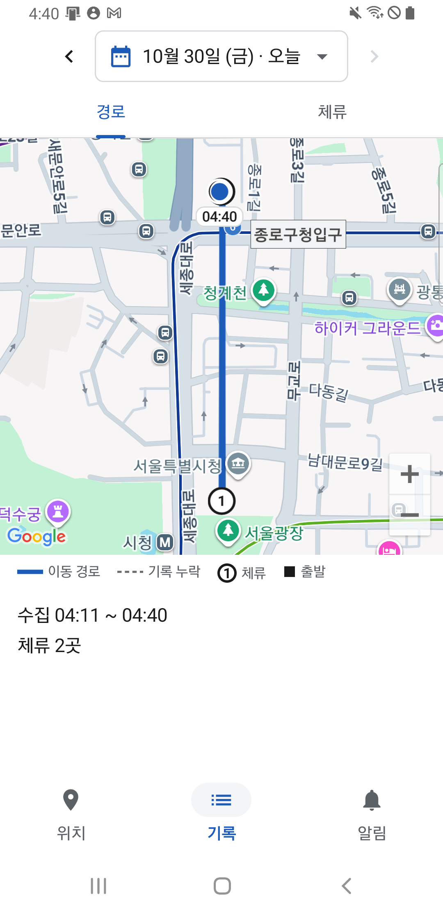
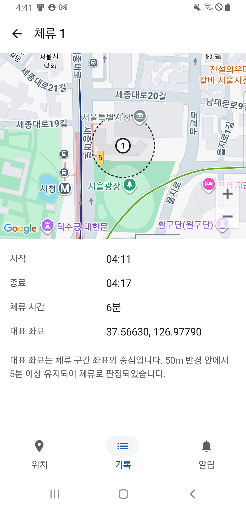
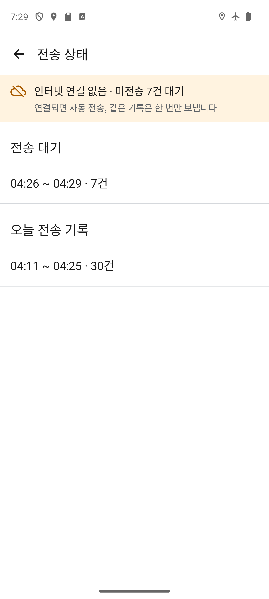

# GPSplace — GPS 머문 장소 기록

보호대상자(노인·아동)의 휴대폰이 30초마다 위치를 기록하고, 연결된 보호자가 최신 위치·이동 경로·체류 장소·구역 알림을 확인하는 Android 앱입니다.

| 항목 | 내용 |
| --- | --- |
| 형태 | 2인 팀 프로젝트 (팀 신서임당: 임재윤, 서지민) |
| 플랫폼 | Android 10 이상 (minSdk 29) |
| 사용 기술 | Kotlin, Jetpack Compose, Room, WorkManager, Google Maps SDK, Firebase (Authentication · Firestore · Cloud Messaging · Cloud Functions) |
| 규모 | Kotlin 75개 파일 약 8,000줄, 화면 17개 |
| 내 역할 | Google Maps API 연동 (지도 위 최신 위치·이동 경로·구역 표시) 등 |
| 개발 방식 | 요구사항 분석서와 UI 설계 문서를 먼저 작성하고, 그 문서를 기준으로 단계별로 구현 |

## 화면

<table>
  <tr>
    <td align="center"></td>
    <td align="center"></td>
    <td align="center"></td>
    <td align="center"></td>
  </tr>
  <tr>
    <td align="center">연결 코드 발급 (보호자)</td>
    <td align="center">연결 동의 (보호대상자)</td>
    <td align="center">위치 기록 (보호대상자)</td>
    <td align="center">이동 경로 (보호자)</td>
  </tr>
  <tr>
    <td align="center"></td>
    <td align="center"></td>
    <td align="center"></td>
    <td align="center"></td>
  </tr>
  <tr>
    <td align="center">체류 상세</td>
    <td align="center">안전 구역 이탈 알림</td>
    <td align="center">갱신 지연 안내</td>
    <td align="center">오프라인 전송 대기</td>
  </tr>
</table>

화면의 위치는 서울시청 주변에 넣은 시험용 좌표입니다. 전체 화면은 [UI 설계서](<docs/UI설계서_신서임당_임재윤,서지민.pdf>)에 있습니다.

## 주요 기능

| 기능 | 내용 | 요구사항 |
| --- | --- | --- |
| 기기 연결 | 보호자가 6자리 코드를 만들고, 보호대상자가 입력하고 동의하면 연결됩니다. 코드는 10분 동안 유효합니다. | FR-01 |
| 위치 수집·경로 표시 | 포그라운드 서비스가 30초마다 위치를 수집하고, 보호자 지도에 최신 위치와 당일 경로를 표시합니다. | FR-02 |
| 체류 기록 | 50m 반경 안에 5분 이상 머물면 체류 장소와 시간을 저장합니다. | FR-03 |
| 구역 알림 | 안전 구역 이탈과 주의 구역 진입을 연속된 위치 2개로 판정해 보호자에게 푸시 알림을 보냅니다. | FR-04 |
| 날짜별 조회 | 날짜를 골라 과거 이동 경로와 체류 기록을 봅니다. | FR-05 |
| 오프라인 기록 | 인터넷이 끊기면 위치를 기기에 저장하고, 다시 연결되면 중복 없이 서버로 보냅니다. | FR-06 |

AI 경로 예측, 건강 정보 연동, 경찰·소방 자동 신고(FR-07~09)는 요구사항 단계에서 구현 범위 밖으로 정했습니다.

## 설계

- **위치를 1시간 단위 문서로 저장**: 위치 한 점을 문서 하나로 만들지 않고 1시간 치를 문서 하나에 묶었습니다. 보호자가 하루 경로를 볼 때 Firestore 문서를 최대 24건만 읽습니다.
- **재전송해도 중복이 생기지 않는 구조**: 수집 시각을 키로 써서 병합 저장합니다. 같은 기록을 다시 보내도 같은 키를 덮어쓸 뿐 점이 늘지 않습니다.
- **서버 규칙으로 접근 제어**: 연결된 보호자와 보호대상자만 위치를 읽을 수 있고, 연결을 해제하면 양쪽 모두 읽을 수 없습니다. Firestore 보안 규칙으로 막고 규칙 테스트로 확인했습니다.
- **판정 로직 분리**: 체류·구역·기록 누락 판정을 Android에 의존하지 않는 순수 Kotlin 코드(`domain/`)로 분리해 단위 테스트를 붙였습니다.
- **금지 권한 검사**: 전화·문자·신체 센서 등 쓰지 않기로 한 권한 5개가 병합된 매니페스트에 들어 있으면 빌드가 실패하도록 Gradle 작업을 만들었습니다.

데이터 모델과 판정 규칙의 상세 내용은 [설계 문서](docs/ARCHITECTURE.md)에 있습니다.

## 시험

2026년 10월 30일 시험 기록([docs/TEST_LOG.md](docs/TEST_LOG.md)) 기준입니다.

| 대상 | 내용 | 결과 |
| --- | --- | --- |
| 판정 로직 단위 테스트 | 체류 판정 10건, 구역 판정 10건 | 20건 통과 |
| Firestore 보안 규칙 테스트 | 연결된 보호자 허용, 미연결·비로그인 거부, 해제 후 거부 등 | 12건 통과 |
| 기기 시험 | Galaxy S9+(보호자)와 에뮬레이터(보호대상자), 실제 Firebase 프로젝트 | FR-01~FR-06 동작 확인 |

실기기 백그라운드 수집 시험과 화면별 응답 시간 측정은 기록 당시 남아 있던 항목입니다.

## 문서

| 문서 | 내용 |
| --- | --- |
| [요구사항 분석서](docs/분석서_신서임당_임재윤서지민_수정본2.pdf) | 기능·비기능 요구사항, 유스케이스, 추적 매트릭스 |
| [UI 설계 보고서](docs/UI설계보고서_신서임당_임재윤서지민.pdf) | 화면 17개의 와이어프레임, 상태 화면, 디자인 기준 |
| [UI 설계서](<docs/UI설계서_신서임당_임재윤,서지민.pdf>) | 구현한 앱의 실제 화면 캡처 |
| [docs/SCREENS.md](docs/SCREENS.md) | 화면 명세 (문구, 상태, 전환) |
| [docs/PLAN.md](docs/PLAN.md) | 단계별 구현 계획과 완료 확인 기준 |
| [docs/TEST_LOG.md](docs/TEST_LOG.md) | 시험 기록 |
| [docs/ARCHITECTURE.md](docs/ARCHITECTURE.md) | 코드 구조, 데이터 모델, 판정 규칙 |

## 사용 방법

보호자와 보호대상자가 각자 자기 휴대폰에 앱을 설치합니다.

필요한 것
- Android 10 이상, Google Play 서비스가 있는 휴대폰 (지도·위치·푸시 알림에 필요)
- 인터넷 (Wi-Fi든 모바일 데이터든 상관없음). 서버는 Firebase 클라우드입니다.
  보호대상자 휴대폰은 인터넷이 끊겨도 위치를 휴대폰에 저장하고, 다시 연결되면 보냅니다.

처음 연결하는 순서
1. 보호자 휴대폰: [보호자] → 6자리 코드가 나옵니다 (10분 동안 유효).
2. 보호대상자 휴대폰: [보호대상자] → 코드 입력 → [동의하고 연결] → [권한 허용하기]에서 위치 권한을 **항상 허용**으로.
3. 보호자 휴대폰에 “연결 완료” → [위치 보기 시작].

알아 둘 점
- 보호대상자 휴대폰은 상단 알림 표시줄에 “위치 기록 중”이 떠 있는 동안 30초마다 기록합니다. 일부 휴대폰은 절전 기능이 백그라운드 앱을 멈추므로, 설정에서 이 앱의 배터리 최적화를 끄면 기록이 더 잘 이어집니다.
- 로그인은 익명 계정입니다. 앱을 지웠다가 다시 설치하면 연결이 끊기므로 다시 연결해야 합니다.

## 직접 빌드하기

설치 파일(APK)은 Firebase 설정과 지도 API 키가 들어 있어 저장소에 넣지 않았습니다. 아래 방법으로 직접 빌드합니다.

준비물: Android Studio (JDK 17 이상), Node.js 22 (서버 함수·규칙 테스트용), Firebase CLI.

비밀 파일은 저장소에 넣지 않았습니다. 빌드하려면 직접 넣어야 합니다.
- `app/google-services.json` — Firebase 콘솔 → 프로젝트 설정 → Android 앱(com.example.gpsplace)에서 내려받기
- `local.properties`에 `MAPS_API_KEY=…` (Google Maps SDK for Android 키)

```
./gradlew assembleDebug                  # 디버그 APK (개발용 “화면 목록” 아이콘 포함)
./gradlew assembleRelease                # 릴리스 APK (서명 필요)
./gradlew testDebugUnitTest              # 판정 로직 단위 테스트 (FR-03·FR-04·FR-05)
./gradlew checkForbiddenPermissions      # 금지 권한 검사 (FR-08·FR-09)
```

서버 (Firestore 데이터베이스 이름 `gpsplace`, 서울 리전)

```
cd functions && npm install
npm run test:rules                       # Firestore 규칙 테스트 (에뮬레이터)
firebase deploy --only firestore         # 보안 규칙·인덱스
firebase deploy --only functions         # 구역 알림 푸시 onAlertCreated
```
