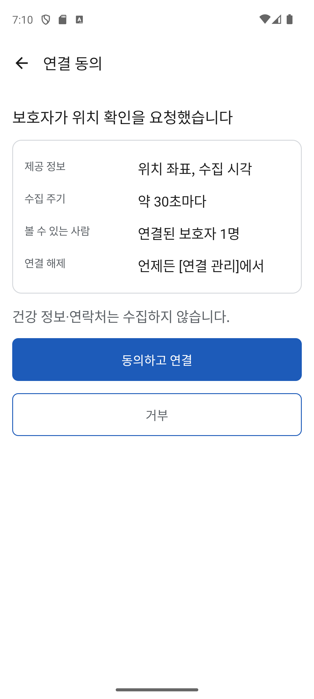
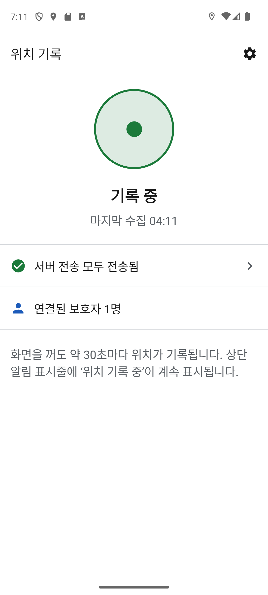
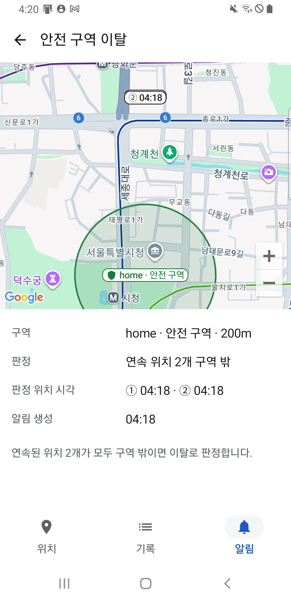
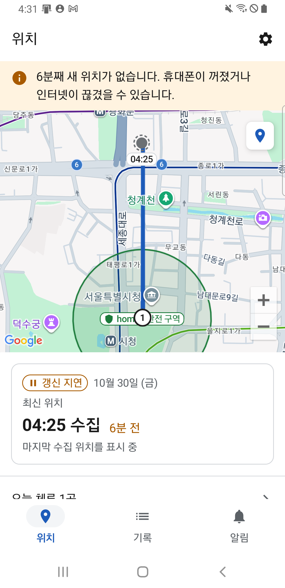

# GPSplace — GPS 머문 장소 기록

보호대상자(노인·아동)의 휴대폰이 30초마다 위치를 기록하고, 연결된 보호자가 최신 위치·이동 경로·체류 장소·구역 알림을 확인하는 Android 앱입니다.

# 화면

<table>
  <tr>
    <td align="center"></td>
    <td align="center"></td>
    <td align="center"></td>
    <td align="center"></td>
  </tr>
  <tr>
    <td align="center">연결 코드 발급 (보호자)</td>
    <td align="center">연결 동의 (보호대상자)</td>
    <td align="center">위치 기록 (보호대상자)</td>
    <td align="center">이동 경로 (보호자)</td>
  </tr>
  <tr>
    <td align="center"></td>
    <td align="center"></td>
    <td align="center"></td>
    <td align="center"></td>
  </tr>
  <tr>
    <td align="center">체류 상세</td>
    <td align="center">안전 구역 이탈 알림</td>
    <td align="center">갱신 지연 안내</td>
    <td align="center">오프라인 전송 대기</td>
  </tr>
</table>

화면의 위치는 서울시청 주변에 넣은 시험용 좌표입니다.

# 주요 기능

| 기능 | 내용 | 요구사항 |
| --- | --- | --- |
| 기기 연결 | 보호자가 6자리 코드를 만들고, 보호대상자가 입력하고 동의하면 연결됩니다. 코드는 10분 동안 유효합니다. | FR-01 |
| 위치 수집·경로 표시 | 포그라운드 서비스가 30초마다 위치를 수집하고, 보호자 지도에 최신 위치와 당일 경로를 표시합니다. | FR-02 |
| 체류 기록 | 50m 반경 안에 5분 이상 머물면 체류 장소와 시간을 저장합니다. | FR-03 |
| 구역 알림 | 안전 구역 이탈과 주의 구역 진입을 연속된 위치 2개로 판정해 보호자에게 푸시 알림을 보냅니다. | FR-04 |
| 날짜별 조회 | 날짜를 골라 과거 이동 경로와 체류 기록을 봅니다. | FR-05 |
| 오프라인 기록 | 인터넷이 끊기면 위치를 기기에 저장하고, 다시 연결되면 중복 없이 서버로 보냅니다. | FR-06 |

AI 경로 예측, 건강 정보 연동, 경찰·소방 자동 신고(FR-07~09)는 요구사항 단계에서 구현 범위 밖으로 정했습니다.

## 설계

- **위치를 1시간 단위 문서로 저장**: 위치 한 점을 문서 하나로 만들지 않고 1시간 치를 문서 하나에 묶었습니다. 보호자가 하루 경로를 볼 때 Firestore 문서를 최대 24건만 읽습니다.
- **재전송해도 중복이 생기지 않는 구조**: 수집 시각을 키로 써서 병합 저장합니다. 같은 기록을 다시 보내도 같은 키를 덮어쓸 뿐 점이 늘지 않습니다.
- **서버 규칙으로 접근 제어**: 연결된 보호자와 보호대상자만 위치를 읽을 수 있고, 연결을 해제하면 양쪽 모두 읽을 수 없습니다. Firestore 보안 규칙으로 막고 규칙 테스트로 확인했습니다.
- **판정 로직 분리**: 체류·구역·기록 누락 판정을 Android에 의존하지 않는 순수 Kotlin 코드(`domain/`)로 분리해 단위 테스트를 붙였습니다.
- **금지 권한 검사**: 전화·문자·신체 센서 등 쓰지 않기로 한 권한 5개가 병합된 매니페스트에 들어 있으면 빌드가 실패하도록 Gradle 작업을 만들었습니다.

# 테스트

2026년 10월 30일 시험 기록([docs/TEST_LOG.md](docs/TEST_LOG.md)) 기준입니다.

| 대상 | 내용 | 결과 |
| --- | --- | --- |
| 판정 로직 단위 테스트 | 체류 판정 10건, 구역 판정 10건 | 20건 통과 |
| Firestore 보안 규칙 테스트 | 연결된 보호자 허용, 미연결·비로그인 거부, 해제 후 거부 등 | 12건 통과 |
| 기기 시험 | Android 기기(보호자)와 에뮬레이터(보호대상자), 실제 Firebase 프로젝트 | FR-01~FR-06 동작 확인 |

화면별 응답 시간(NFR-02)은 2026년 11월 20일 실기기(보호자)에서 홈·경로 지도·체류 목록을 각 10회 재서 모두 목표 안에 들어왔습니다. 실기기(Galaxy S9+) 백그라운드 시험도 같은 날 실내에서 했습니다. 화면 꺼짐·최근 앱 제거·절전(Doze)에서는 약 32초 간격으로 기록이 이어졌고, 강제 종료하면 다시 열 때까지 멈췄습니다. 실외 이동 시험은 남아 있습니다.

# 사용 방법

보호자와 보호대상자가 각자 자기 휴대폰에 앱을 설치합니다.

필요한 것
- Android 10 이상, Google Play 서비스가 있는 휴대폰 (지도·위치·푸시 알림에 필요)
- 인터넷 (Wi-Fi든 모바일 데이터든 상관없음). 서버는 Firebase 클라우드입니다.
  보호대상자 휴대폰은 인터넷이 끊겨도 위치를 휴대폰에 저장하고, 다시 연결되면 보냅니다.

처음 연결하는 순서
1. 보호자 휴대폰: [보호자] → 6자리 코드가 나옵니다 (10분 동안 유효).
2. 보호대상자 휴대폰: [보호대상자] → 코드 입력 → [동의하고 연결] → [권한 허용하기]에서 위치 권한을 **항상 허용**으로.
3. 보호자 휴대폰에 “연결 완료” → [위치 보기 시작].

알아 둘 점
- 보호대상자 휴대폰은 상단 알림 표시줄에 “위치 기록 중”이 떠 있는 동안 30초마다 기록합니다. 일부 휴대폰은 절전 기능이 백그라운드 앱을 멈추므로, 설정에서 이 앱의 배터리 최적화를 끄면 기록이 더 잘 이어집니다.
- 로그인은 익명 계정입니다. 앱을 지웠다가 다시 설치하면 연결이 끊기므로 다시 연결해야 합니다.

# 문서

| 문서 | 내용 |
| --- | --- |
| [요구사항 분석서 (수정본 2)](docs/분석서_신서임당_임재윤서지민_수정본2.pdf) | FR-01~09, NFR-01~05, 유스케이스 |
| [UI 설계서](docs/UI설계서_신서임당_임재윤,서지민.pdf) | 화면 S-01~S-17, 상태 화면, 뒤로가기, 접근성 점검 |
| [구현 기술 확정 보고서](docs/구현기술확정보고서_신서임당_임재윤,서지민.pdf) | 선정 기준, 후보 비교, 직접 실측, 위험과 대안 |
| [최종 보고서](docs/최종보고서_신서임당.pdf) | 문제 정의, 모바일 필연성, 실제 동작 화면, 겪은 문제, 못한 것 |
| [시연 영상 촬영 가이드·대본](docs/시연영상_촬영가이드_대본_신서임당.pdf) | 장면 구성, 테이크 순서, 해설 대본 |
| [설계 문서](docs/ARCHITECTURE.md) | 데이터 모델, 판정 규칙, 빌드 환경 |
| [시험 기록](docs/TEST_LOG.md) | 요구사항별 시험 결과 |
